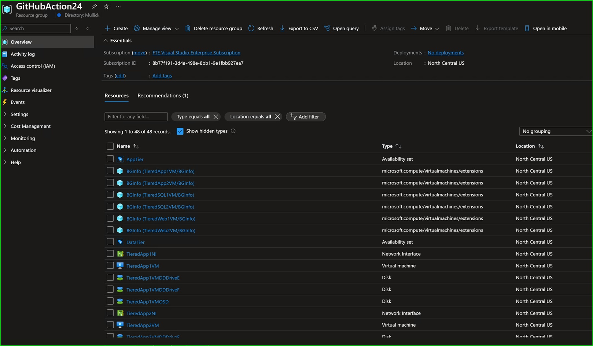
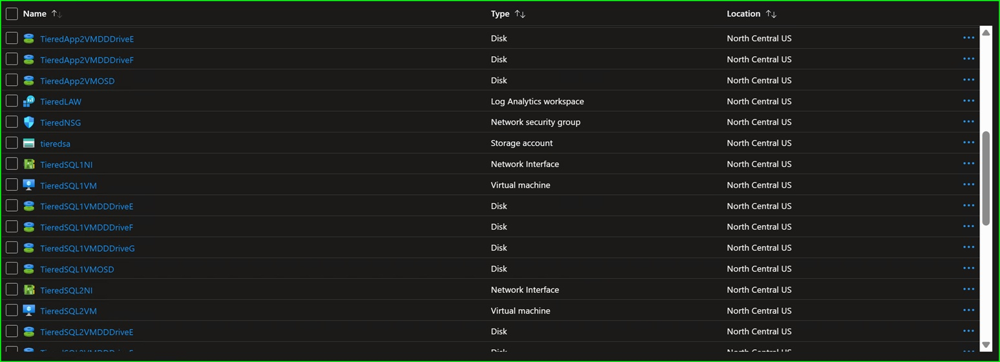
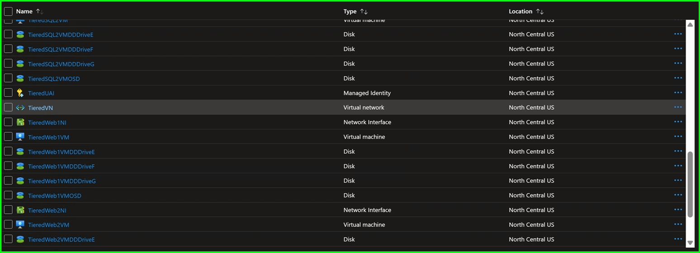
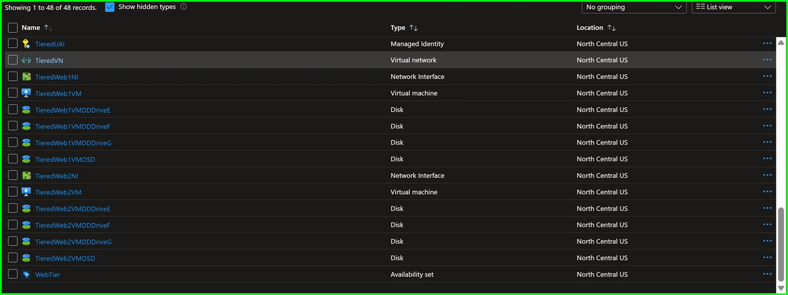

# Three Tier Applicaiton Infrastructure deployment in Azure

This is deploying a [three-tier application architecture][1] on virtual machines in Azure.

<u>Naming Standard</u>

[Naming Convention] (% include https://raw.githubusercontent.com/Ayanmullick/AzIaaS/refs/heads/main/3TierApp/NamingConvention.md %)

[Abbreviatons] (% include https://raw.githubusercontent.com/Ayanmullick/AzIaaS/refs/heads/main/3TierApp/Abbreviations.md %) 

[Virtual Machines] (% include https://raw.githubusercontent.com/Ayanmullick/AzIaaS/refs/heads/main/3TierApp/VMs.md %) [open]

Currently the 'Sparse checkout' feature is blocked by bug.
[sparse-checkout not working when running in a container. · Issue #1602 · actions/checkout][4]

One could get more detailed in their implementation of the code.
Potential Tables: vNet details, NSG rules, VM details, storage account restrictions
Potential environment variables: RG name, KV, Sa, secret, admin name,

One could put all tabularizable configuration in a markdown table and the other configurations in a hash table.

This gives you a single source of truth for configuration and documentation unlike other declarative methods that could result in a doc-config mismatch.
And adding to configuration doesn't require you to add to the code. One could also parameterize the table paths once the table data has been validated.

The tables could be generated with proper Excel formulas.

  

These are the NSG rules to allow SSL and Windows Admin Center traffic.

[Network Security Group Rules] (% include https://raw.githubusercontent.com/Ayanmullick/AzIaaS/refs/heads/main/3TierApp/NsgRules.md %) 

<figure style="float:right; margin:0; max-width: 20%;">
  
  <figcaption style="text-decoration: underline">Visio diagram for output resources</figcaption>
</figure>

This prestages the governance resources in Azure for the VMs' Deployment job.

Governance resources

<!-- code-include: {"path":"./GovResource.ps1","region":"GovernanceResources","language":"powershell"} -->

This prestages the Network resources in Azure for the VMs' Deployment job.

Network resources

<!-- code-include: {"path":"./GovResource.ps1","region":"NetworkResources","language":"powershell"} -->

This passes the resources' details between the Governance resources and the VM deployment jobs in the GitHub Actions workflow.

Output for next job

<!-- code-include: {"path":"./GovResource.ps1","region":"OutputForNextJob","language":"powershell"} -->

Here is a link to the [Governance resources deployment execution][2]

This deploys the required virtual machines in the same resource group using the previously prestaged governance resources.

Virtual machine creation

<!-- code-include: {"path":"./VMs.ps1","region":"VirtualMachineCreation","language":"powershell"} -->

Here is a link to the [VM deployment execution][3]

<u>Azure portal screenshots</u>

  

       
  

  

     
     
     
  

 

  
<u>Essential characteristics</u>

Correct, Deterministic, Efficient, Robust, Maintainable, Testable, Reliable, Reusable, Flexible, Scalable, Secure, BAU\BC lang parity

https://www.geeksforgeeks.org/software-engineering-characteristics-of-good-software
https://biosistemika.com/blog/dont-save-on-quality-key-attributes-of-software

≠ Idempotent\Incremental,Stateless  #How many orders of magnitude more lines of code just for this

[1]: <https://learn.microsoft.com/en-us/azure/architecture/guide/architecture-styles/#n-tier>
[2]: <https://ayanmullick.github.io/AzIaaS/Render/LogRender.html?path=https://raw.githubusercontent.com/Ayanmullick/AzIaaS/refs/heads/main/3TierApp/AzPSImageInfraDeploymentWithApproval%20GovernanceResourcesJob.log>
[3]: <https://ayanmullick.github.io/AzIaaS/Render/LogRender.html?path=https://raw.githubusercontent.com/Ayanmullick/AzIaaS/refs/heads/main/3TierApp/AzPSImageInfraDeploymentWithApproval%20DeployVirtualMachines.log>
[4]: <https://github.com/actions/checkout/issues/1602#issuecomment-2048656906>
