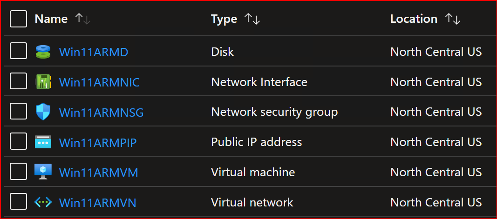

# Azure PowerShell to deploy Win11 Arm VM

I wanted to explore [Azure Cobalt VMs][1]. This example uses Azure PowerShell to deploy a [Generation 2][2] Windows 11 Arm VM on Cobalt 200 with Trusted Launch and boot diagnostics. The sample resource names follow a basic [naming convention][11].

[Read in FieldNotes][12] · [Launch Azure Cloud Shell](https://shell.azure.com/powershell) · [View PowerShell source](../AzVM/AzVM.ps1)

<figure style="float:right; margin:0; max-width: 30%;">
  
  <figcaption style="text-decoration: underline">Azure portal resources from an earlier deployment</figcaption>
</figure>

Sign in to the intended Azure subscription and create `Win11ArmRG` before running the example. The script uses `Win11Arm` as the name prefix and `centralus` for the resources. `$Scope` holds the resource group name, and `$Params` adds the location for cmdlets that need it. Both are reused through [splatting][3]. Run this example with resource names that are available in the target group.

<details open>
<summary id="Variables">Variables</summary>

<!-- code-include: {"path":"../AzVM/AzVM.ps1","region":"Variables","language":"powershell"} -->

</details>

The network configuration creates a virtual network, a subnet with an NSG, and a public IP attached to the VM's network interface. The interface uses [accelerated networking][4]. Replace `<YourIP>` in the RDP rule with your public IP address or CIDR.

<details>
<summary id="NetworkConfiguration">Network configuration</summary>

<!-- code-include: {"path":"../AzVM/AzVM.ps1","region":"NetworkConfiguration","language":"powershell"} -->

</details>

The VM uses [`Standard_E4ps_v7`][5], a Standard SSD OS disk, and the `latest` version of `win11-26h2-ent` from the [Windows 11 Arm preview offer][10]. The configuration explicitly enables [Trusted Launch][8], [Secure Boot][9], and vTPM. It also sets the time zone, enables [automatic updates][6], and turns on [boot diagnostics][7]. Replace `<>` with your VM administrator password.

<details open>
<summary id="VirtualMachineConfiguration">Virtual machine configuration</summary>

<!-- code-include: {"path":"../AzVM/AzVM.ps1","region":"VirtualMachineConfiguration","language":"powershell"} -->

</details>

## Deploy and verify

`New-AzVM` uses `-IfNoneMatch '*'` to prevent that request from updating an existing VM. The script then installs the [Guest Attestation extension][13] for boot integrity monitoring and displays the VM's security settings, OS status, and extension provisioning state.

<!-- code-include: {"path":"../AzVM/AzVM.ps1","region":"DeployAndVerifyVM","language":"powershell"} -->

<details>
<summary>Output from the earlier deployment</summary>

```text
RequestId IsSuccessStatusCode StatusCode ReasonPhrase
--------- ------------------- ---------- ------------
                         True         OK OK
```

</details>

[1]:  <https://learn.microsoft.com/en-us/azure/virtual-machines/sizes/cobalt-overview>
[2]:  <https://learn.microsoft.com/en-us/azure/virtual-machines/generation-2#features-and-capabilities>
[3]:  <https://learn.microsoft.com/en-us/powershell/module/microsoft.powershell.core/about/about_splatting>
[4]:  <https://learn.microsoft.com/en-us/azure/virtual-network/accelerated-networking-overview>
[5]:  <https://learn.microsoft.com/en-us/azure/virtual-machines/sizes/memory-optimized/epsv7-series>
[6]:  <https://learn.microsoft.com/en-us/azure/virtual-machines/automatic-vm-guest-patching#azure-powershell-when-creating-a-windows-vm>
[7]:  <https://learn.microsoft.com/en-us/troubleshoot/azure/virtual-machines/boot-diagnostics>
[8]:  <https://learn.microsoft.com/en-us/azure/virtual-machines/trusted-launch>
[9]:  <https://learn.microsoft.com/en-us/azure/security/fundamentals/secure-boot>
[10]: <https://azuremarketplace.microsoft.com/en-us/marketplace/apps/microsoftwindowsdesktop.windows11preview-arm64>
[11]: <https://learn.microsoft.com/en-us/azure/cloud-adoption-framework/ready/azure-best-practices/resource-naming>
[12]: <https://ayan.mullick.in/FieldNotes?path=https://raw.githubusercontent.com/Ayanmullick/AzIaaS/main/Blog/DeployWindows11ArmVM.md>
[13]: <https://learn.microsoft.com/en-us/azure/virtual-machines/trusted-launch#microsoft-defender-for-cloud-integration>
